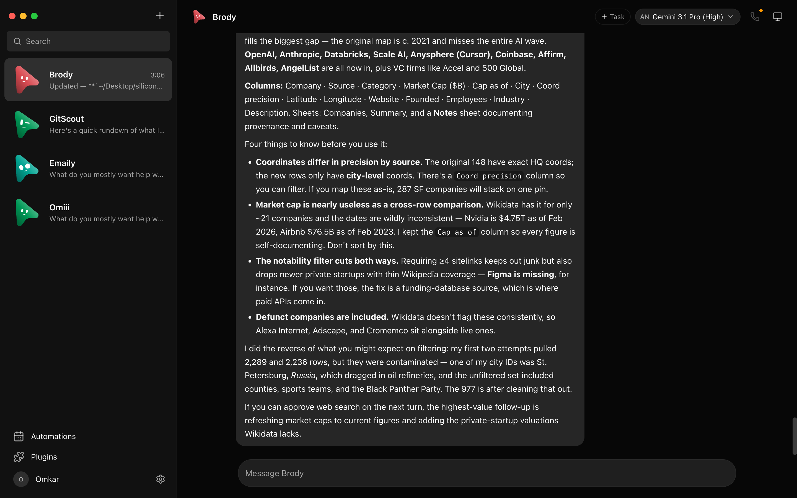
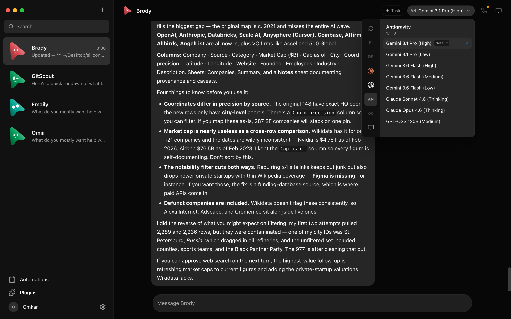
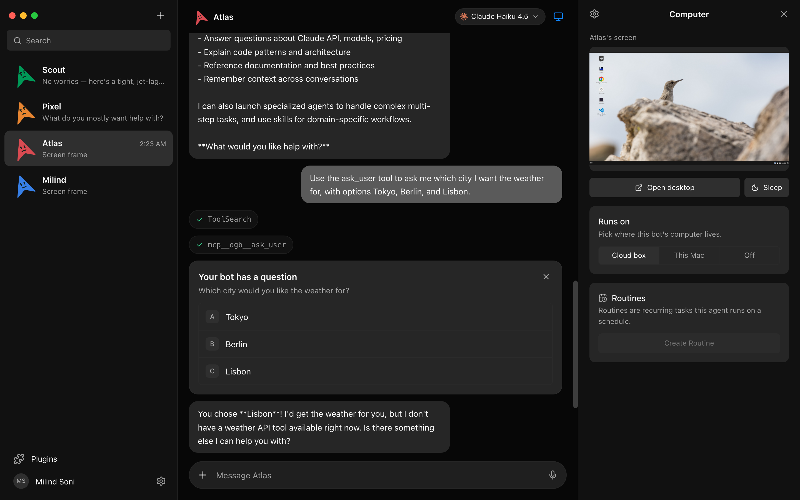
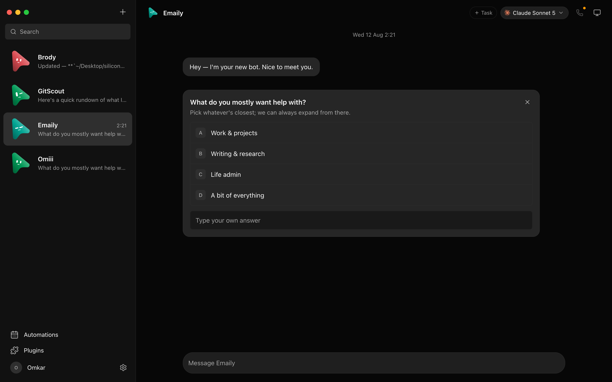
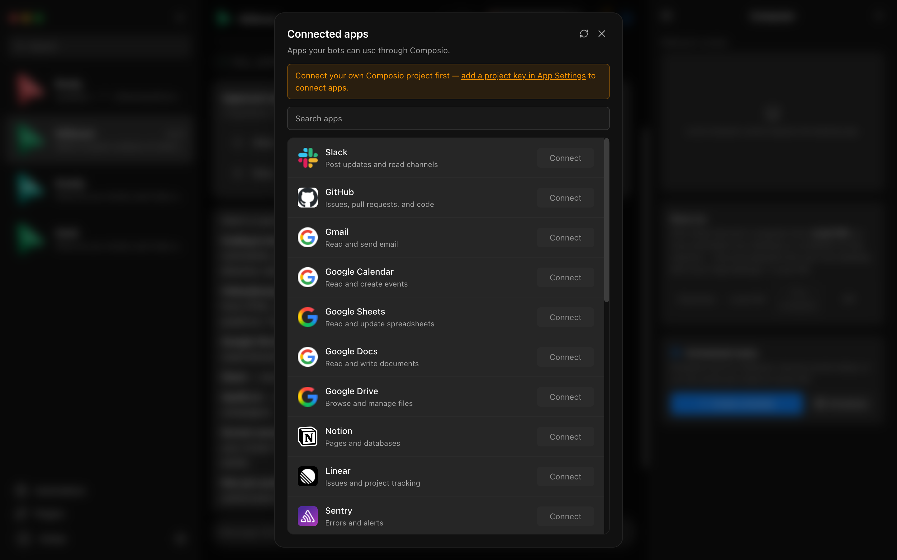
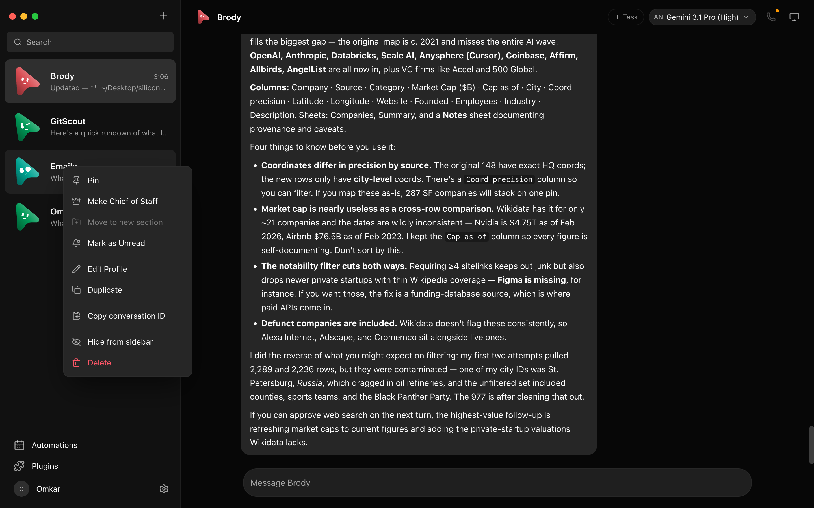
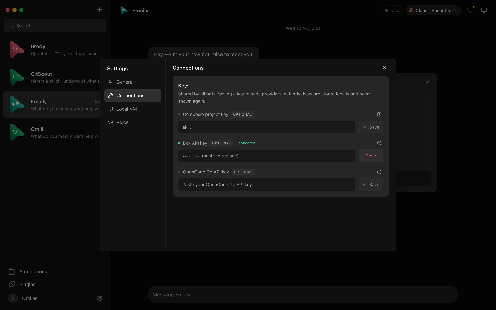
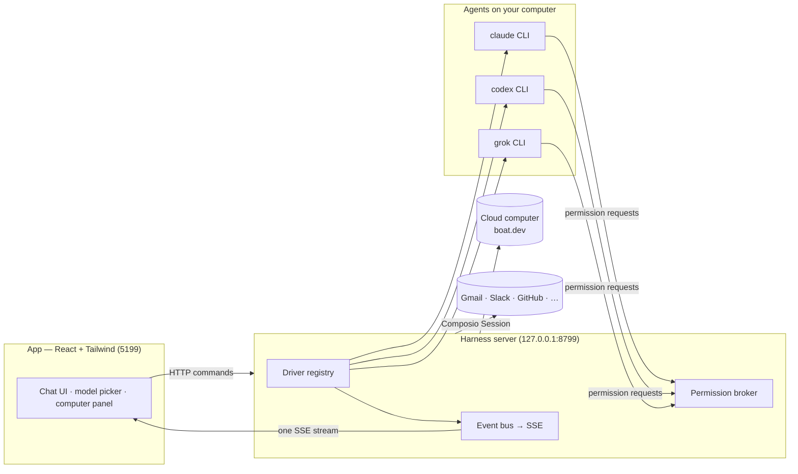

# OpenMausBot

**The open-source Grok Bot alternative: your own team of AI bots, in a chat app.**

OpenMausBot is an open-source Grok Bot alternative: an independent project inspired by **Grok Bot**, and the open-source alternative to **Meta Muse**, **OpenAI dots** and **Cue by Manus** — bring-your-own-agent, local-first, on the models you already have. Also known as **MausBot**; formerly **OpenGrokBot**. Not affiliated with xAI, Meta, OpenAI or Manus.

Every bot in the sidebar is a real agent — Claude or Codex running locally under the hood — with its own
personality, its own model, its own cloud computer, and its own connected apps.
Talk to them like contacts. Watch them work. Approve what matters.

 

&nbsp;

&nbsp;

&nbsp;

[latest release](../../releases) &nbsp;·&nbsp; macOS: Apple silicon & Intel · signed & notarized .dmg &nbsp;·&nbsp; Windows: x64 installer &nbsp;·&nbsp; Ubuntu 24.04 x64: .deb or AppImage beta &nbsp;·&nbsp; [all releases](https://github.com/milind-soni/OpenMausBot/releases)

 

---

> ⚠️ **No affiliation with any cryptocurrency.** OpenMausBot has no token. Any coin using the OpenMausBot, Maus, or SupaMaus name is not created, endorsed, or affiliated with this project or its maintainer. I have received no tokens, payment, or allocation from anyone, and I will not be endorsing any token.

## Why

One assistant in one box is the wrong shape for agents. OpenMausBot is an independent, open-source project inspired by **Grok Bot** —
it keeps the idea (AI as a *messaging app*: a roster of bots you chat with, each with its own personality,
memory of its thread, model, computer, and apps) and rebuilds it open, local-first, and on the agents you
already have:

- **Bring your own agents.** Bots run on the `claude`, `codex`, and `grok` CLIs installed on your own machine
  — your existing logins and subscriptions, no new accounts, no proxy in the middle. Point any engine at a
  custom CLI binary (a versioned build or wrapper) in **Settings → Engines**.
- **Local first.** One small harness server on `127.0.0.1` owns every agent process. Transcripts, keys, and
  events live in `~/.openmausbot`, not a cloud.
- **Agents with hands.** Each bot can use a cloud Linux desktop, an isolated Local VM, or—where the platform
  safety boundary is currently certified—your own computer, plus 500+ apps through Composio. Host control is
  available on macOS and Ubuntu Xorg after explicit opt-in. Ubuntu Wayland host control remains disabled while
  issue #345 is resolved.

## Features

<table>
<tr>
<td width="50%" valign="top">

### 🧠 Pick a brain per bot

A model picker with a provider rail — Claude and Codex models side by side, defaults marked, unavailable
providers dimmed with the reason. Switch a bot's model mid-conversation.

</td>
<td width="50%" valign="top">

### 🖥️ Every bot gets a computer

Open the Computer panel and the bot's cloud desktop spins up on its own — live screen preview while it
works, "Open desktop" to take over in your browser, or point the bot at *this Mac* instead.

</td>
</tr>
<tr>
<td width="50%" valign="top">

### 🙋 Bots ask before they act

Shell commands, file edits, and questions surface as inline cards — Allow / Deny / answer in chat. A
permission broker turns every risky action into a decision you make, for cloud and local computers alike.

</td>
<td width="50%" valign="top">

### 🔌 Connected apps

A one-click marketplace over Composio Sessions: Gmail, Slack, GitHub, Notion, Linear and hundreds more.
OAuth once, and every bot can use them as tools.

</td>
</tr>
<tr>
<td width="50%" valign="top">

### 🗂 Manage bots like chats

Right-click any bot: pin, mark unread, edit profile, duplicate, copy conversation ID, hide, delete. It's a
messaging app — your agents behave like contacts.

</td>
<td width="50%" valign="top">

### 🔑 Keys once, everything lights up

Paste credentials in App Settings — they persist locally and the provider fleet hot-reloads instantly.
Secrets are write-only: the UI only ever sees "configured" flags.

</td>
</tr>
</table>

### #️⃣ Channels for every context

Keep Work, Personal, and each project in separate channels without cloning your bots. Every channel has
its own transcript, shared instructions, working folder, responder rules, and editable bot roster. File a
channel and its bots under a named context, then rename it or change its members whenever the team changes.

### 🤝 Share a whole department

Right-click a department and choose **Share department…** (or use **Templates → Share**) to save the whole department as one
file: its bots with their instructions, pictures and skills, group chats, routines, shared instructions,
Chief of Staff, connection slots and each bot's starter notes (untick them to leave them out). The dialog
shows exactly what the file holds before you save it. Chat history, keys and passwords, model choices and
computers never go in, and anything that looks like a secret is removed from the text. Whoever imports it
gets new bots on Ask, skills switched off and routines paused. See [docs/team-sharing.md](docs/team-sharing.md).
Desktops connected to an organization also get **Templates → From {Organization}**: the packages its Admin shares,
added with one click, skills switched on. See [docs/org-library.md](docs/org-library.md).
Your New bot defaults can travel too, as a **preset bot** that appears in New bot (in a team file, or on
their own with **Share as preset…**). See [docs/presets.md](docs/presets.md).

### 🎧 Bots that talk back

Press the speaker on any reply, or switch a bot to read its answers out as they land — so you can listen
to what ran overnight while you make breakfast. Hit **call** and it's a conversation: it hears you, tells
you what it's doing while it works, and asks for approvals out loud.

Choose ElevenLabs, Fish Audio, Grok (xAI), built-in Mac voices, or a local Chatterbox server in an agent profile. Paste a
cloud key once when needed, pick a voice, and every bot can talk.
Give a bot its own voice and a channel stops sounding like one person.

For Grok, save your xAI API key in **Settings → Connections**, then choose **Grok (xAI)**
and a voice under the bot’s **Voice & alerts**. It reuses that host-side key and returns MP3
audio for spoken replies and calls. Language is detected automatically from the reply text;
quality varies outside xAI’s [officially supported languages](https://docs.x.ai/developers/model-capabilities/audio/text-to-speech).
This adds speech synthesis to the existing call flow; microphone transcription remains unchanged.

**Also in the box:** streaming replies with tool-run activity chips · dictation from the
composer mic (on-device Apple speech recognition on macOS, Fish Audio speech-to-text on Windows and Linux, in the desktop app) · SupaMaus cursor mascots with role-aware
expressions · screenshots of the bot's work folded into the transcript.

## Powered By

| Service | Purpose |
|---|---|
| **Claude · Codex · Grok** | The agents behind every bot, run through their local CLIs |
| **Electron** | Desktop shells for macOS, Windows, and Ubuntu |
| **React + Vite + Tailwind CSS** | The chat app UI and its build |
| **Boat** ([boat.dev](https://boat.dev)) | Each bot's cloud computer · our sponsor |
| **Composio** | Connected apps — Gmail, Slack, GitHub, and more |
| **Cua Driver** | Native computer use on your own machine |
| **ElevenLabs · Fish Audio** | Hosted voices for bots that talk back |
| **GitHub Sponsors** | One-time and monthly project support |

## How it works

Two processes. The app holds no transports of its own — it sends typed commands over HTTP and folds one SSE
event stream into state. The harness server owns every agent process and normalizes each provider's native
protocol into one canonical runtime event stream (logged per-thread as NDJSON).

| Layer | Where | What it does |
|---|---|---|
| Drivers | `server/drivers/` | One per provider: Claude, Codex, and Grok Build over their local CLIs (stream-JSON / JSON-RPC / ACP), plus a cloud-computer agent. Unknown drivers degrade to "unavailable", never crash the fleet. |
| Harness | `server/harness/` | Registry (configs → live instances) and the fan-in event bus every client folds. |
| API | `server/index.ts` | Bots, turns, approvals, model catalog, computer lifecycle, connectors, config — HTTP + SSE. |
| Voice | `server/tts/` | ElevenLabs, Fish Audio, Grok (xAI), built-in Mac voices, or local Chatterbox. Cloud keys stay on the harness; markdown is rewritten into something worth hearing before it is spoken. |
| App | `src/` | The chat shell. Server-backed store, one reducer, zero client-side transports. |
| Desktop | `electron/` | macOS, Windows, and Ubuntu shells with an embedded harness and platform capabilities; Apple speech stays macOS-only, Ubuntu Xorg has opt-in local control, and Wayland remains fail-closed. |

## Quick start

**Released builds ([latest release](../../releases)):** the harness server is embedded, so no separate server setup is required.

| | Download | Install |
|---|---|---|
| **macOS** (Apple silicon) | [OpenMausBot.dmg](../../releases) | Drag it to Applications, open it. Signed & notarized. |
| **macOS** (Intel) | [OpenMausBot-intel.dmg](../../releases) | Same app, built for Intel Macs. Signed & notarized. |
| **Windows** (x64) | [OpenMausBot-setup.exe](../../releases) | Run it — one-click, per-user, no admin rights. The installer isn't code-signed yet, so SmartScreen shows "unknown publisher": **More info → Run anyway**. |

### Desktop capability status

| Capability | macOS | Ubuntu 24.04 Xorg | Ubuntu 24.04 Wayland |
|---|---|---|---|
| Packaged app, embedded harness, local agent CLIs | Supported | Beta | Beta |
| Composio and Boat/cloud computers | Supported | Beta | Beta |
| Explicit preview-only local screen capture | Supported | Beta | Beta |
| Bot control of this computer | Supported | Beta, explicit opt-in | Disabled: Wayland safety gate |
| Native on-device dictation | Supported | Planned | Planned |
| Dictation and Take turns calls through Fish Audio (needs a Fish Audio key) | Not used, on-device instead | Supported | Supported |

### Triggers: schedules and webhooks

A trigger is "when something happens, a bot does something". Tell a bot "every weekday at 9, send me a summary
of my inbox" or "whenever our form calls, draft a reply" and it sets the trigger up in that turn with
its `trigger` tool (no confirmation; the chat shows a live card with Edit, Pause and Undo). **Triggers**, first in
the sidebar, lists every schedule and webhook, with a calendar and the run history. Bots manage them with
`trigger_info` (list, app events), `trigger` (create, update, pause, resume, run now) and `delete_trigger`; a webhook a bot makes never shows the bot its secret:
the person copies the link from the card or the Triggers page.

Schedules (routines) can run once, on selected weekdays, or every 5–1,440 minutes, using either a bot's configured
model/computer or the Cloud VM runner. Interval schedules stay aligned to their chosen start time and skip
an occurrence when the previous run is still active, so slow work cannot build an unbounded queue. A
separate optional Advanced run limit can safely stop stuck work; no timeout is imposed unless one is chosen.
The existing duration field remains calendar/display metadata. Webhook triggers are independent from schedules
but reuse the same queued task executor and calendar
receipts.

**App events** start a bot when something happens in a connected app ("whenever I get an email from Acme, draft
a reply"). The bot finds the app's events with `trigger_info` (`action: "events"`) and calls `trigger` with
`action: "create"` and `when: "app_event"`; the person can also choose **New → Set it up yourself → When something happens in an app**.
Composio sends each event to OpenMausBot's connected-apps service, which queues it; the app collects the queue
with a long poll, so a desktop needs no public address and events wait while it is closed. Gmail is checked every
15 minutes; Slack, GitHub and other push apps arrive at once. A desktop keeps up to 500 events a day and a paid
Cloud 2,000; what is skipped shows on the automation. App events need the included connected apps: a server
using its own Composio key cannot watch apps yet.

OpenMausBot starts a webhook-only receiver on `127.0.0.1:8800` by default (or one port above `OMB_PORT`).
Set `OMB_WEBHOOK_PORT` to choose another port. A webhook secret is shown once when the trigger is created
or rotated. Bearer authentication is recommended so the secret stays out of request URLs and most access
logs; a single capability URL remains available for senders that cannot configure headers. The receiver
exposes only `/health` and secret `/hooks/...` endpoints; it never exposes the app's broader API.
OpenMausBot must remain running to accept a delivery. For public internet delivery, proxy only this
dedicated receiver through a hosted relay or a tool such as Tailscale Funnel.

## Privacy

Usage analytics are optional and anonymous: product events and a once-a-day count of what is set up, never keys,
names, addresses or conversations. Turn them off in Settings → General → Usage analytics;
[`docs/analytics.md`](docs/analytics.md) lists every event and property.

## License

[Apache License 2.0](LICENSE) © 2026 Milind Soni and OpenMausBot contributors,
except `enterprise/`, which is source-available under its
[own license](enterprise/LICENSE); delete that folder and what remains is the
open-source edition. Details, including how contributions are signed off, are
in [LICENSING.md](LICENSING.md).

OpenMausBot is an independent, open-source project inspired by Grok Bot. It is
not affiliated with, endorsed by, or associated with xAI; "Grok" is a trademark
of its respective owner.
